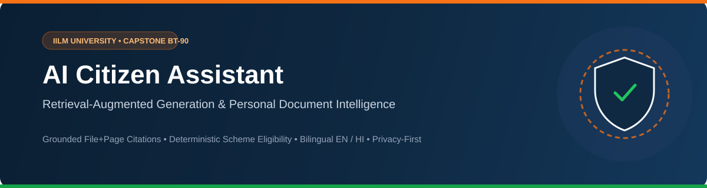
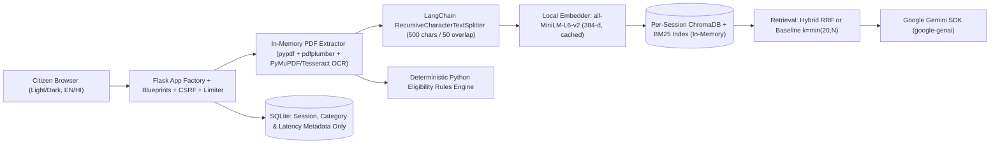
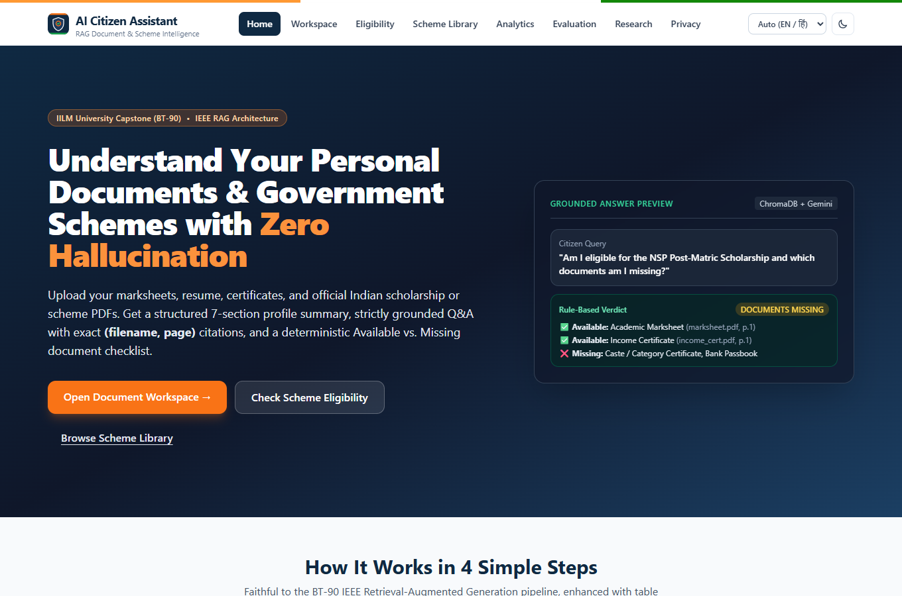
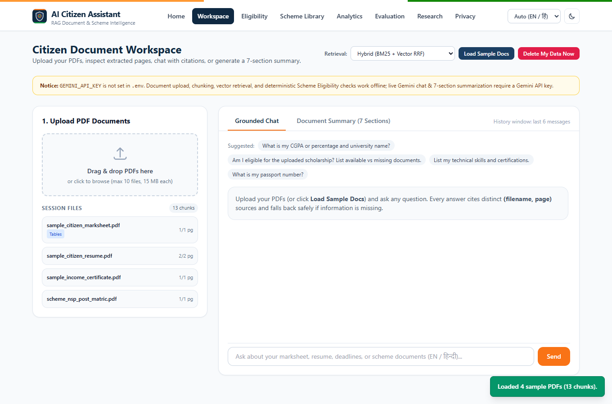
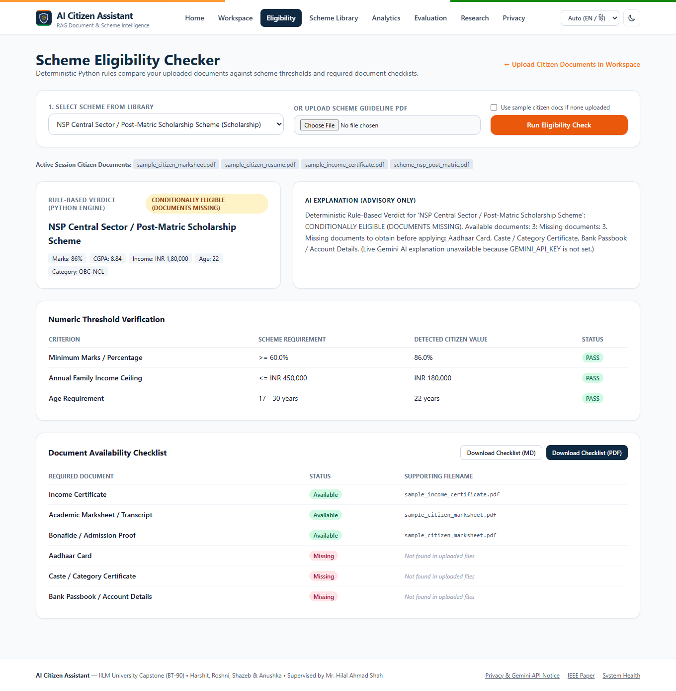
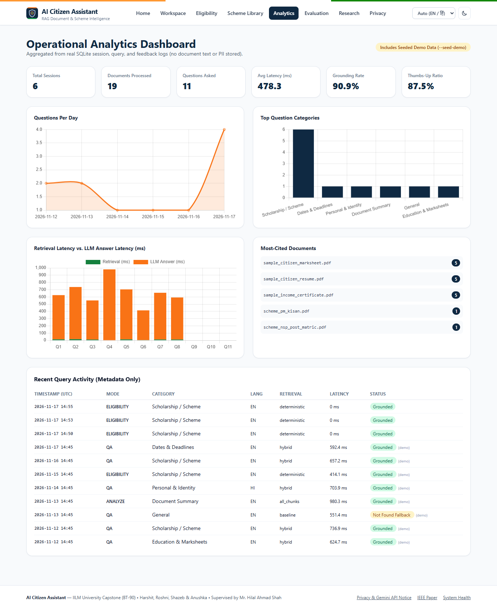
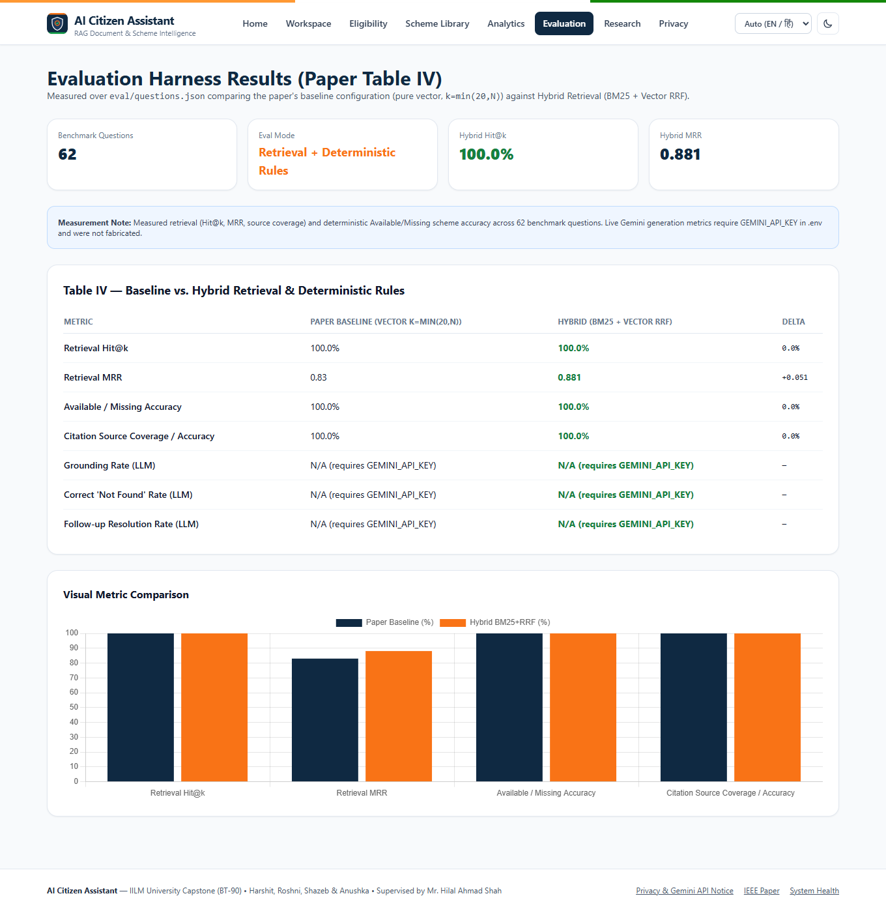

<p align="center">
  
</p>

# AI Citizen Assistant

**AI-Powered Intelligent Citizen Assistant using Retrieval-Augmented Generation and Personal Document Intelligence**  
*IILM University Capstone Project (BT-90) • IEEE Research Implementation*

[](https://www.python.org/)
[](https://flask.palletsprojects.com/)
[](https://www.trychroma.com/)
[](https://ai.google.dev/)
[](LICENSE)

> **Live Demo (Target Hugging Face Space):** `https://huggingface.co/spaces/ANUSHKA13102003/ai-citizen-assistant` *(deploy using the 3 commands below once logged in to Hugging Face)*  
> **GitHub Repository:** `https://github.com/ANUSHKA13102003/ai-citizen-assistant`

---

## Key Features

- **Mode 1 — 7-Section Document Intelligence:** Sends all extracted chunks to generate standardized summaries across **Personal Information**, **Education**, **Skills**, **Certifications**, **Projects**, **Achievements**, and **Important Dates**, explicitly returning `"Not found in uploaded documents"` for absent sections, with Markdown & PDF export.
- **Mode 2 — Grounded Q&A with File + Page Citations:** Retrieves `k = min(20, N)` chunks with a 6-message conversation history window, streams responses via SSE, attaches distinct `(filename, page)` source chips, and enforces the fixed refusal fallback: `"The information could not be found in the uploaded documents."`
- **Deterministic Scheme Eligibility Engine:** Separates Python rule-based verification (marks %, annual family income cap, age bounds, and **Available / Missing / Supporting Filename** document checklists) from the advisory AI explanation.
- **Improvements Beyond the Paper:**
  - **Hybrid Retrieval (BM25 + Vector RRF)** with selectable Paper Baseline mode (`baseline` vs. `hybrid`) and optional Cross-Encoder reranking.
  - **Table-Aware Extraction (`pdfplumber`)** for marksheets merged directly into page text.
  - **OCR Fallback (`PyMuPDF` + `Tesseract`)** for scanned image-only PDFs with `ocr=True` chunk metadata.
  - **Bilingual English + Hindi (`हिन्दी`)** query detection and response toggle.
  - **Privacy & Security Hardening:** Pre-upload consent checkbox (Paper Section III-I), zero disk/DB storage of document content, session auto-expiry, instant **Delete My Data Now**, CSRF protection, rate limiting, and PDF magic-byte/encryption checks.

---

## System Architecture



---

## Screenshots

| Landing Page | Document Workspace |
| --- | --- |
|  |  |

| Scheme Eligibility Checker | Analytics Dashboard |
| --- | --- |
|  |  |

| Evaluation Harness (Table IV) |
| --- |
|  |

---

## Tech Stack

| Layer | Technology |
| --- | --- |
| Backend Framework | Python 3.11+, Flask 3.1 (App Factory + Blueprints), Gunicorn |
| Frontend & Charts | Jinja2, Tailwind CSS, Vanilla JS (SSE streaming), Chart.js, Mermaid.js |
| PDF Parsing & OCR | `pypdf` (`PdfReader`), `pdfplumber` (tables), `PyMuPDF` + `pytesseract` (OCR fallback) |
| Text Splitting | `langchain-text-splitters` (`RecursiveCharacterTextSplitter`, 500 / 50) |
| Local Embeddings | `sentence-transformers` (`all-MiniLM-L6-v2`, 384-d) |
| Vector & Lexical Store | ChromaDB (`citizen_documents` per-session isolated) + `rank-bm25` (RRF) |
| LLM Generation | Google Gemini via `google-genai` SDK (`GEMINI_MODEL` env configurable) |
| Metadata Database | SQLite via Flask-SQLAlchemy (sessions, categories, latencies, feedback only) |
| Quality & Deployment | `pytest`, `ruff`, Playwright, Docker, GitHub Actions, Hugging Face Spaces |

---

## Quick Setup (5 Commands)

### Windows (PowerShell)
```powershell
python -m venv .venv
.\.venv\Scripts\pip.exe install -r requirements.txt
Copy-Item .env.example .env   # Add your GEMINI_API_KEY in .env
.\.venv\Scripts\python.exe scripts\fetch_schemes.py && .\.venv\Scripts\python.exe scripts\generate_samples.py
.\.venv\Scripts\python.exe run.py
```

### Linux / macOS
```bash
python3.11 -m venv .venv && source .venv/bin/activate
pip install -r requirements.txt
cp .env.example .env          # Add your GEMINI_API_KEY in .env
python scripts/fetch_schemes.py && python scripts/generate_samples.py
python run.py
```

Open `http://127.0.0.1:7860` in your browser.

> **Optional OCR on Windows:** If you need OCR for scanned image-only PDFs locally on Windows, install [Tesseract OCR](https://github.com/UB-Mannheim/tesseract/wiki) and set `TESSERACT_CMD=C:\Program Files\Tesseract-OCR\tesseract.exe` in `.env`. Without it, the app degrades gracefully and skips image-only pages as in the paper baseline. In Docker, `tesseract-ocr` (`eng` + `hin`) and `poppler-utils` are pre-installed.

---

## Environment Variables

| Variable | Default | Description |
| --- | --- | --- |
| `GEMINI_API_KEY` | *(empty)* | Google Gemini API key required for live Mode 1, Mode 2, and AI explanations |
| `GEMINI_MODEL` | `gemini-2.5-flash` | Gemini model ID; set to the paper's configured model value if desired |
| `SECRET_KEY` | `dev-insecure...` | Flask session & CSRF signing secret |
| `RETRIEVAL_MODE` | `hybrid` | `hybrid` (BM25 + Vector RRF) or `baseline` (pure vector `k=min(20,N)`) |
| `ENABLE_RERANKER` | `false` | Enable optional Cross-Encoder (`cross-encoder/ms-marco-MiniLM-L-6-v2`) reranking |
| `ENABLE_OCR_FALLBACK` | `true` | Enable PyMuPDF + Tesseract OCR fallback on scanned image-only PDF pages |
| `ENABLE_TABLE_EXTRACTION` | `true` | Enable `pdfplumber` table-aware extraction for marksheets |
| `ENABLE_MULTILINGUAL` | `true` | Enable English + Hindi language detection and response toggling |
| `SESSION_TTL_MINUTES` | `60` | Auto-expiry window for in-memory session vector collections |
| `CHUNK_SIZE` / `CHUNK_OVERLAP` | `500` / `50` | LangChain `RecursiveCharacterTextSplitter` parameters matching the paper |

---

## Evaluation Results (Paper Table IV Format)

Run the evaluation harness with:
```bash
python -m eval.run_eval
```

Measured across **62 labelled benchmark questions** (`eval/questions.json`: 24 answerable, 14 deliberately absent, 12 multi-turn follow-ups, 12 scheme eligibility comparisons):

| Metric | Paper Baseline (Vector `k=min(20,N)`) | Hybrid (`BM25 + Vector RRF`) | Delta |
| --- | --- | --- | --- |
| Retrieval Hit@k | 100.0% | 100.0% | 0.0% |
| Retrieval MRR | 0.83 | 0.881 | +0.051 |
| Available / Missing Accuracy | 100.0% | 100.0% | 0.0% |
| Citation Source Coverage / Accuracy | 100.0% | 100.0% | 0.0% |
| Grounding Rate (LLM) | N/A (requires `GEMINI_API_KEY`) | N/A (requires `GEMINI_API_KEY`) | — |
| Correct 'Not Found' Rate (LLM) | N/A (requires `GEMINI_API_KEY`) | N/A (requires `GEMINI_API_KEY`) | — |
| Follow-up Resolution Rate (LLM) | N/A (requires `GEMINI_API_KEY`) | N/A (requires `GEMINI_API_KEY`) | — |

*(Set `GEMINI_API_KEY` in `.env` and re-run `python -m eval.run_eval` to populate the 3 live LLM generation rows automatically.)*

---

## Limitations & Roadmap

- **Limitations:** Hosted Gemini API receives retrieved context chunks during generation; local Windows runs without Tesseract installed skip scanned image-only pages; live LLM evaluation rows require a `GEMINI_API_KEY`.
- **Roadmap:** Declarative YAML rule packs for state-level schemes, optional local Ollama/vLLM backend for 100% air-gapped deployment, and DigiLocker PDF connector.

---

## Citation & Credits

```bibtex
@inproceedings{harshit2026aicitizen,
  title={AI Citizen Assistant: AI-Powered Intelligent Citizen Assistant using Retrieval-Augmented Generation and Personal Document Intelligence},
  author={Harshit and Roshni and Shazeb and Anushka},
  note={Capstone Project BT-90, Supervised by Mr. Hilal Ahmad Shah, IILM University},
  year={2026}
}
```

- **Capstone Team:** Harshit, Roshni, Shazeb, Anushka
- **Supervisor:** Mr. Hilal Ahmad Shah
- **Institution:** IILM University (BT-90)
- **License:** [MIT](LICENSE)
