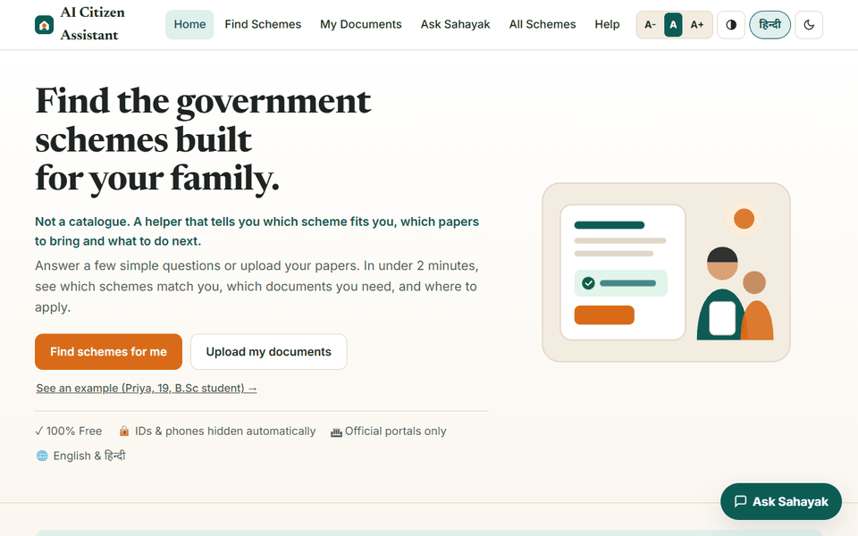
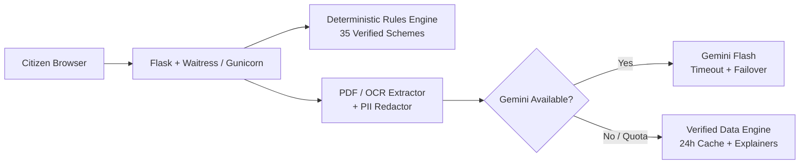

# AI Citizen Assistant

A free bilingual (English & हिन्दी) web helper that lets Indian citizens check government scheme eligibility, inspect their documents, and get grounded guidance in under 2 minutes.

[](https://ai-citizen-assistant-7wzg.onrender.com)
[](https://github.com/ANUSHKA13102003/ai-citizen-assistant/actions/workflows/ci.yml)
[](LICENSE)



## The problem

Millions of eligible citizens miss scholarships, pensions, and welfare benefits because official guidelines are scattered across long PDFs and portals in dense legal language. First-time applicants on mobile phones need to know *which* schemes fit them, *which* documents they need, and *where* to apply without guesswork.

## What it does

- **2-Minute Scheme Finder:** Matches age, state, income, category, and occupation against 35 HTTP-verified Central and Uttar Pradesh schemes with a *Check your answers* review step.
- **Document Checker & Checklist:** Reads uploaded PDFs or phone photos (marksheets, income/caste/domicile certificates), auto-fills details with page citations, and exports a missing-document PDF checklist.
- **Sahayak Bilingual Assistant:** Answers questions in English, हिन्दी, or Hinglish using verified scheme data and optional Gemini Flash AI with automatic fallback so visitors never see key or quota errors.

## Try it in 30 seconds

Open the live app at **https://ai-citizen-assistant-7wzg.onrender.com** (or run locally):

1. Click **Check what you qualify for**, pick a profile, review **Check your answers**, and view matched schemes.
2. Open **My Documents**, load the demo documents, and see auto-filled marks/income with page citations.
3. Open **Ask Sahayak**, switch to **हिन्दी**, and ask *"UP Post Matric Scholarship ke liye kya documents chahiye?"*

## How it works



## Built with

| Layer | Stack |
| :--- | :--- |
| **Backend** | Python 3.11, Flask 3.1, Waitress (local), Gunicorn (production) |
| **AI & Retrieval** | `google-genai` (Gemini Flash), `rank-bm25`, Gemini embeddings, verified-data fallback |
| **Documents & OCR** | `pypdf`, `pdfplumber`, `PyMuPDF`, `pytesseract` (EN/HI), `reportlab` |
| **Frontend & Tests** | Jinja2, `en.json` / `hi.json` i18n, `pytest`, Playwright E2E, `ruff` |

## Run locally

**Windows (PowerShell):**
```powershell
git clone https://github.com/ANUSHKA13102003/ai-citizen-assistant.git; cd ai-citizen-assistant
python -m venv .venv; .\.venv\Scripts\pip install -r requirements-dev.txt
copy .env.example .env
.\scripts\run_dev.ps1
```

**Linux / macOS:**
```bash
git clone https://github.com/ANUSHKA13102003/ai-citizen-assistant.git && cd ai-citizen-assistant
python3 -m venv .venv && .venv/bin/pip install -r requirements-dev.txt
cp .env.example .env
.venv/bin/python run.py
```

## Privacy and safety

- **Personal numbers hidden before AI:** Aadhaar-like 12-digit numbers, PAN, bank accounts, phone numbers, and emails are redacted before any text is sent to Gemini.
- **Nothing stored:** Uploaded documents stay only in ephemeral session memory and are cleared when the session ends or when you click **Clear my data**.
- **Official-site links:** Every scheme links directly to its verified `.gov.in` / official portal, and Sahayak reminds citizens never to pay middlemen or share OTPs.

## Quality

| Check | Result |
| :--- | :--- |
| **Automated Suite (`pytest`)** | 27 passed (unit, auto-fill, chaos resilience, Playwright E2E) |
| **Official Link Check** | 23 / 23 scheme & portal URLs returned HTTP 200 |
| **Chat Evaluation** | 40 / 40 live eval + 40 / 40 verified-data mode; 100% grounding (`eval/results.json`) |
| **Memory Footprint** | 259.5 MB peak RSS (fits Render 512 MB free tier) |

## Roadmap

- Expand state-level scheme libraries for Bihar, Madhya Pradesh, Rajasthan, and Maharashtra.
- Add offline-installable PWA support for low-connectivity rural areas.
- Add WhatsApp / Telegram bot adapter using the same verified rules and explainer engine.
- Support regional voice output in additional Indian languages.
