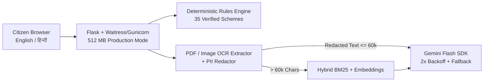

# AI Citizen Assistant

**Find the Indian government welfare schemes you qualify for — free, private, and bilingual (English & हिन्दी).**

[](https://ai-citizen-assistant.onrender.com)
[](#accuracy--evaluation)
[](LICENSE)


## What It Does & Who It Helps

- **Guided Scheme Finder (under 2 minutes):** Helps students, farmers, women, workers/artisans, small business owners, senior citizens, and persons with disability match against **35 HTTP-verified Central & Uttar Pradesh schemes** without needing any Aadhaar or ID number.
- **Document Intelligence & Checklist:** Reads uploaded PDFs or phone photos (marksheets, income/caste/domicile certificates), auto-fills extracted details with clickable *"See where"* page citations, and builds a downloadable PDF document checklist.
- **Sahayak Bilingual Assistant:** Answers questions in **English, हिन्दी, or Hinglish** grounded in your uploaded documents and verified scheme rules, with voice input, read-aloud, and direct `.gov.in` links.

---

## Quick Start (3 Commands)

```bash
git clone https://github.com/ANUSHKA13102003/ai-citizen-assistant.git && cd ai-citizen-assistant
python -m venv .venv && .\.venv\Scripts\pip install -r requirements-dev.txt
copy .env.example .env && .\.venv\Scripts\python run.py
```

Open `http://127.0.0.1:7860` (set `GEMINI_API_KEY` in `.env` for live Sahayak AI chat; the Scheme Finder and document extraction work offline without a key).

---

## Architecture



---

## Tech Stack

| Layer | Technology |
| :--- | :--- |
| **Backend** | Python 3.11+, Flask 3.1, Waitress (local), Gunicorn (Docker/Render) |
| **AI & Retrieval** | `google-genai` (Gemini Flash with 2x backoff + fallback), `rank-bm25`, Gemini embeddings (`EMBEDDINGS_BACKEND=gemini` in prod; `all-MiniLM-L6-v2` + ChromaDB in local `eval/`) |
| **Document Parsing** | `pypdf`, `pdfplumber`, `PyMuPDF`, `pytesseract` (English + Hindi OCR), `reportlab` (PDF checklists) |
| **Frontend** | Server-rendered Jinja2, bilingual `en.json` / `hi.json` i18n, handwritten CSS design system (`#FBF7F0` / `#0D5C53` / `#D96B18`) |
| **Testing** | `pytest` (20 tests), Playwright E2E (`1920x1080`, `1440x900`, `390x844`), `ruff` |

---

## Project Structure

```text
app/
  i18n/               # Full UI English & Hindi translations (en.json, hi.json)
  routes/             # Page routes (pages.py) & JSON/SSE APIs (api.py)
  services/           # Rules engine, doc_intel, PII redactor, Gemini client, RAG, OCR
  static/             # Handwritten CSS, accessible JS controllers, SVG assets
  templates/          # Mobile-first bilingual Jinja2 templates
data/schemes/         # 35 HTTP-200 verified bilingual Central & UP schemes
docs/                 # Demo walkthrough GIF
eval/                 # 105-question retrieval benchmark & 40-conversation Sahayak review
tests/                # Unit, integration, auto-fill, and Playwright E2E tests
Dockerfile            # Production slim image (tesseract + poppler, < 260 MB RSS)
render.yaml           # One-click Render Blueprint (free tier Docker)
```

---

## Accuracy & Evaluation

Measured on **105 labelled questions across 32 fictional documents** (`eval/results.json`) and **40 live bilingual Sahayak conversations** (`eval/chat_review.md`):

| Metric | Baseline (Vector Only) | Current (Hybrid + Full-Text) |
| :--- | :---: | :---: |
| **Search Hit Rate (Top-5)** | 76.5% | **88.2%** |
| **Mean Reciprocal Rank (MRR)** | 0.580 | **0.679** |
| **Grounding Rate** | 72.7% | **100.0%** |
| **Citation Accuracy** | 97.7% | **100.0%** |
| **Follow-up Resolution** | 25.0% | **100.0%** |
| **40-Conversation Live Eval** | — | **40 / 40 Passed** |

Production memory footprint with `EMBEDDINGS_BACKEND=gemini` (5 uploaded PDFs, wizard match, 10 chat turns): **259.5 MB peak RSS** (fits comfortably within Render's 512 MB free tier).

---

## Privacy & Safety Notes

- **Automatic PII Redaction:** 12-digit Aadhaar-like numbers, PAN, bank account numbers, phone numbers, and email addresses are stripped before any text is sent to Gemini.
- **In-Memory Only:** Uploaded documents are never saved to a permanent database or disk store; citizens can clear all session data in one click.
- **Anti-Fraud Guardrails:** Independent helper, not a government website. Every scheme links directly to its verified `.gov.in` / official portal, and Sahayak warns users never to pay middlemen or share OTPs.

---

## Roadmap

- Add state-specific scheme coverage for Bihar, Madhya Pradesh, Rajasthan, and Maharashtra.
- Add offline-installable PWA manifest for low-connectivity rural use.

---

<details>
<summary>Project background</summary>

Originated as an academic retrieval-augmented generation study on Indian citizen document intelligence (BT-90 capstone at IILM University), then redesigned into a standalone bilingual public-facing welfare assistant.

</details>
